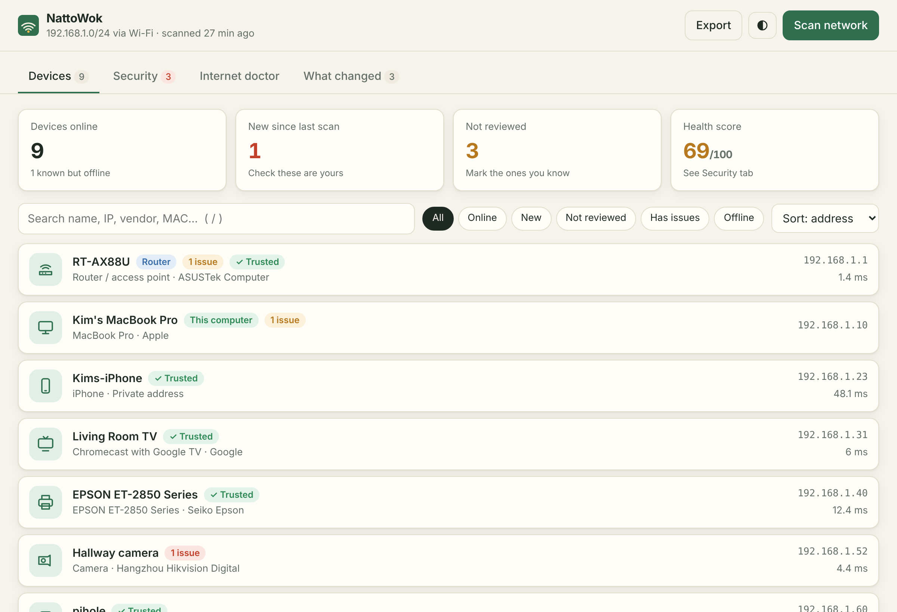
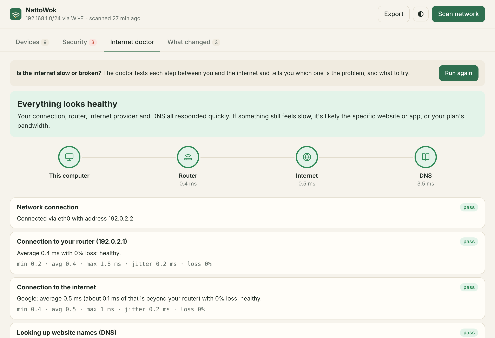

# NattoWok Scanner

**See who's on your network, what each device actually is, and whether anything needs fixing, explained in plain language.**

NattoWok is a network scanner in the spirit of Fing. It's built around a different question, though: not just *"what's connected?"* but *"what does this mean for me, and what should I do?"* It's a single Rust binary with a local web dashboard and a scriptable CLI. No account, no cloud, no telemetry.


<sub>Screenshots use sample data.</sub>

## What it does differently

| Everyday frustration | What NattoWok does |
|---|---|
| "Unknown device" with no explanation | Every guess comes with its **reasons** ("Reports Apple model iPhone15,2", "Port 9100 is open (printing)") and a **confidence score**, so you can judge it yourself. |
| Phones showing as "unknown vendor" and looking scary | Recognises **private (randomized) Wi-Fi addresses** and explains that this is a normal privacy feature of phones and laptops. |
| Security warnings full of jargon | Each finding says **what it means and what to do**, in plain language. If something is intentional, **dismiss it** and it stops counting against your score. |
| "The internet is slow" with no idea why | The **Internet doctor** tests each hop (this computer → Wi-Fi → router → internet provider → DNS), tells you **which one is the problem**, and benchmarks DNS servers to suggest a faster one. On Wi-Fi it reads signal strength and counts neighbouring networks on your channel, so it can say *"weak signal, move closer"* or *"crowded channel, switch to 11"* instead of just "Wi-Fi is bad". It also spots Wi-Fi sign-in pages, and scans flag Wi-Fi with no password or outdated (WEP/WPA1) security. |
| Having to remember what changed | A **timeline** of devices joining, leaving, changing address, or opening new ports. Mark devices you recognise as trusted, and anything new stands out. |
| "Which box is this mystery device?" | Turn on **Live mode** and unplug things one at a time. The moment a device stops answering, its row turns red and NattoWok asks *"Is that what you unplugged? Name it."* The name sticks when you plug it back in. |
| Phones coming back as "new" after changing their private address | When a newcomer matches a recently offline device (same name, model, ports, address…), NattoWok **carries the name over** automatically if it's certain, or asks *"Is this Sam's phone?"* with the reasons. |
| Laptops mixing up home, office and café devices | Each network gets **its own inventory**, told apart by the router's hardware address. If your usual devices show up behind an unfamiliar router, you get a warning about possible impersonation. |
| Needing an account or a phone app | Runs entirely on your computer. Nothing is uploaded anywhere. |
| Needing root/admin | Discovery works **without root**: TCP probing (a refused connection proves a host is alive), the OS neighbor table, mDNS/Bonjour, UPnP/SSDP and NetBIOS. |
| Explaining your network to whoever helps you with tech | **Export a report** (Markdown) to send them, a CSV for spreadsheets, or JSON for scripts. |
| Not knowing what's reachable from the internet | NattoWok asks your router which ports apps and devices **opened to the internet** (UPnP), and rates each one: remote desktop and databases are serious, game and voice-chat ports are normal. It also spots when your provider shares your public address, so forwards can't actually be reached. |
| Only finding out about a new device when you happen to look | `nattowok service install` keeps NattoWok running in the background (starting at log-in), **scanning on a schedule and sending desktop notifications** for new devices and security issues. No admin rights needed. |
| Wanting automation | `nattowok watch --on-new-device "…"` runs your command when something joins (send a notification, log it, turn on a light). |

### Devices explain themselves


### Security advice you can act on


### Internet doctor



## Install

You need [Rust](https://rustup.rs) (stable, 1.88 or newer).

```sh
git clone https://github.com/nasi-lemak/NattoWokScanner
cd NattoWokScanner
cargo install --path .
```

This puts a single self-contained `nattowok` binary in `~/.cargo/bin`. The vendor database and the dashboard are compiled in.

## Use

```sh
nattowok            # opens the dashboard at http://localhost:7878 and runs a first scan
```

Everything is also available from the terminal:

```sh
nattowok scan                       # find devices, identify them, check for problems
nattowok scan --target 10.0.0.0/24  # scan a specific range (up to /20)
nattowok scan --no-ports --json     # quick scan, machine-readable
nattowok devices                    # everything known on this network, online or not
nattowok doctor                     # why is the internet slow?
nattowok ports "Hallway camera"     # check ~1,100 ports on one device
nattowok label 192.168.1.52 --name "Hallway camera" --trust --tag outdoor
nattowok live                       # watch devices answer in real time; unplug one to find it
nattowok merge 192.168.1.88 "Sam's phone"   # tell NattoWok two entries are one device
nattowok wake "Office PC"           # Wake-on-LAN
nattowok export md -o report.md     # a report for whoever helps you with tech
nattowok networks                   # the networks NattoWok remembers
nattowok info                       # this computer's network settings
```

Devices can be referred to by name, IP or MAC.

### Naming a mystery device

Every device can be named, unknown ones included. Names are tied to the device's hardware address, so they survive unplugging, reboots and IP changes. To work out which physical box an entry is:

1. Turn on **Live** above the device list (or run `nattowok live`).
2. Unplug or switch off devices one at a time.
3. When a row turns red with *"stopped answering"*, that's the one. Click **Name it**.

Live mode can only follow devices that answer quick checks. The rare device that ignores everything shows *"not answering"* from the start; for those, run a scan before and after unplugging and look at what went offline.

### Keep watching in the background

```sh
nattowok service install            # scan every 15 min, notify about new devices and issues
nattowok service install --every 60 --no-notifications
nattowok service status
nattowok service test-notification
nattowok service uninstall
```

This installs a per-user service (a systemd user unit on Linux, a LaunchAgent on macOS, a log-on task on Windows) that runs the dashboard and scans on schedule. Opening `nattowok` afterwards just opens the running dashboard. The interval and notifications can also be changed from the bell menu in the dashboard. Notifications use what your OS already has: `notify-send` on Linux, Notification Center on macOS, toast notifications on Windows.

### Run your own command on changes

```sh
nattowok watch --interval 300 \
  --on-new-device 'notify-send "New device on Wi-Fi" "$NATTOWOK_MESSAGE"'
```

Hooks receive details as environment variables (`NATTOWOK_EVENT`, `NATTOWOK_MESSAGE`, `NATTOWOK_DEVICE_NAME`, `NATTOWOK_DEVICE_IP`, `NATTOWOK_DEVICE_MAC`, `NATTOWOK_DEVICE_VENDOR`, `NATTOWOK_DEVICE_KIND`). They are never spliced into the command text, so a device can't inject shell commands through its name. `--on-event` fires for every change: devices leaving, returning, changing address, opening ports, new security issues.

## How it works

A scan takes about 5–20 seconds on a typical home network:

1. **Find devices.** Every address in your subnet gets a TCP connect on a few common ports. Open *or refused* both prove the host is alive. The system `ping` is used too when available. Meanwhile NattoWok listens for mDNS/Bonjour and UPnP/SSDP announcements.
2. **Read the neighbor table.** Those probes force the OS to ARP every address, so the ARP table reveals even devices that drop all traffic, along with their MAC addresses.
3. **Ask for names.** Reverse DNS against your router (which usually knows DHCP names), unicast mDNS, and NetBIOS.
4. **Check services.** About 40 ports that matter for identification and security, plus banners and web page titles.
5. **Identify.** Clues from the vendor (embedded IEEE registry, ~40k entries), Bonjour services and TXT records (Apple model ids, Google Cast models, printer models), UPnP descriptions, hostnames, ports and banners each add weighted votes, and the winning kind keeps its reasons.
6. **Advise and remember.** Security rules run, the result is compared with the network's inventory, and changes become timeline events.

Data lives in your OS data folder (`~/.local/share/nattowok`, `~/Library/Application Support/nattowok`, `%APPDATA%\nattowok`), or in `$NATTOWOK_DATA` / `--data-dir`. There's one plain JSON inventory per network.

## Privacy and safety

- **Local only.** The only traffic leaving your network comes from the Internet doctor: a few TCP connects and DNS queries to Cloudflare, Google and Quad9, plus Google's standard connectivity check. And only when you run it.
- **The dashboard listens on localhost by default.** Every API call needs a random per-run token embedded in the page, which other websites can't read. Requests whose `Host` isn't localhost are refused, which blocks DNS-rebinding attacks. `--listen 0.0.0.0:7878` exposes it on purpose; access then requires a key printed in the terminal.
- **Polite scanning.** NattoWok only connects. It never logs in, never tries passwords, and only follows UPnP description URLs that point back at the device that announced them.
- **Router exposure is read-only.** NattoWok asks the router for its port-forwarding list; it never adds or removes mappings.
- Only scan networks you own or are allowed to scan.

## Limitations

- IPv4 only for discovery. On networks bigger than /22, the /24 around you is scanned unless you pass `--target`.
- Identification is a well-reasoned guess. Devices that reveal nothing about themselves stay "Unknown" rather than being labelled wrongly. Give them a name and NattoWok will remember it.
- Wi-Fi access-point isolation (common on guest networks) hides other devices from any scanner.
- The doctor measures latency, loss and DNS speed, not bandwidth. Use a speed test for that.
- Wi-Fi details come from `nmcli` (NetworkManager) on Linux, `system_profiler` on macOS and `netsh` on Windows. Recent macOS versions hide the network name unless the app has Location access; signal and channel still work. Windows output is parsed in English.

## Development

```sh
scripts/check.sh                    # formatting, lints and tests: run before pushing
cargo run -- scan                   # run from source
```

There's no hosted CI; `scripts/check.sh` is the check.

Layout:

| Path | What |
|---|---|
| `src/scan.rs` | Orchestrates a scan |
| `src/probe.rs`, `neighbors.rs`, `mdns.rs`, `ssdp.rs`, `netbios.rs`, `dns.rs` | Discovery primitives |
| `src/identify.rs` | Explainable device identification |
| `src/security.rs` | Plain-language findings and health score |
| `src/store.rs` | Per-network inventory, change tracking, merging |
| `src/matching.rs` | Recognising devices that return under a new hardware address |
| `src/doctor.rs`, `src/wifi.rs` | Internet doctor, Wi-Fi signal and channel readings |
| `src/upnp.rs` | Router port-forwarding (exposure) queries |
| `src/notify.rs`, `src/service.rs`, `src/settings.rs` | Desktop notifications, background service, preferences |
| `src/web.rs`, `web/` | Dashboard server and UI (embedded at compile time) |
| `src/main.rs` | CLI |

The vendor table in `data/oui.tsv.gz` is generated from the IEEE MA-L registry:

```sh
curl -o oui.csv https://standards-oui.ieee.org/oui/oui.csv
cargo run --example build_oui -- oui.csv data/oui.tsv.gz
```

## License

MIT
