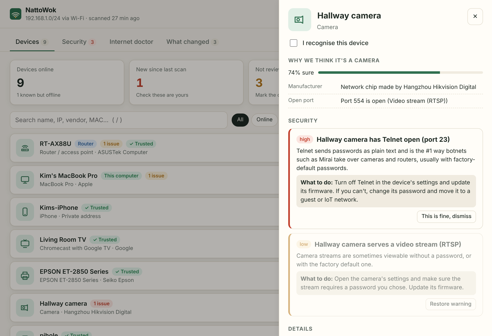
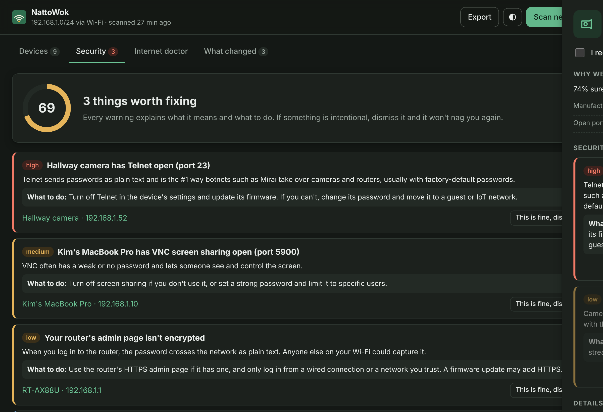

# NattoWok Scanner

**See who's on your network, what each device actually is, and whether anything needs fixing, explained in plain language.**

NattoWok is a network scanner in the spirit of Fing. It's built around a different question, though: not just *"what's connected?"* but *"what does this mean for me, and what should I do?"* It's a single Rust binary with a local web dashboard and a scriptable CLI. No account, no cloud, no telemetry.


<sub>Screenshots use sample data.</sub>

## What it does differently

| Everyday frustration | What NattoWok does |
|---|---|
| "Unknown device" with no explanation | Every guess comes with its **reasons** ("Reports Apple model iPhone15,2", "Port 9100 is open (printing)") and a **confidence score**, so you can judge it yourself. |
| Phones showing as "unknown vendor" and looking scary | Recognises **private (randomized) Wi-Fi addresses** and explains that this is a normal privacy feature of phones and laptops. |
| Security warnings full of jargon | Each finding says **what it means and what to do**, in plain language. If something is intentional, **dismiss it** and it stops counting against your score. |
| "The internet is slow" with no idea why | The **Internet doctor** tests each hop (this computer → Wi-Fi → router → internet provider → DNS), tells you **which one is the problem**, and benchmarks DNS servers to suggest a faster one. On Wi-Fi it reads signal strength and counts neighbouring networks on your channel, so it can say *"weak signal, move closer"* or *"crowded channel, switch to 11"* instead of just "Wi-Fi is bad". It also spots Wi-Fi sign-in pages, and scans flag Wi-Fi with no password or outdated (WEP/WPA1) security. |
| Having to remember what changed | A **timeline** of devices joining, leaving, changing address, or opening new ports. Mark devices you recognise as trusted, and anything new stands out. |
| "Which box is this mystery device?" | Turn on **Live mode** and unplug things one at a time. The moment a device stops answering, its row turns red and NattoWok asks *"Is that what you unplugged? Name it."* The name sticks when you plug it back in. |
| "Why can't I print / cast to the TV?" | Open the device and press **Find out why** (or `nattowok why printer`). NattoWok checks whether it's on, whether it **moved to a new address** (and where), whether its printing or casting service still answers, whether it still announces itself so phones can find it, and whether the network blocks discovery or hides devices from each other. Each problem comes with what to do. |
| Phones coming back as "new" after changing their private address | When a newcomer matches a recently offline device (same name, model, ports, address…), NattoWok **carries the name over** automatically if it's certain, or asks *"Is this Sam's phone?"* with the reasons. |
| Laptops mixing up home, office and café devices | Each network gets **its own inventory**, told apart by the router's hardware address. If your usual devices show up behind an unfamiliar router, you get a warning about possible impersonation. |
| Needing an account or a phone app | Runs entirely on your computer. Nothing is uploaded anywhere. |
| Needing root/admin | Discovery works **without root**: TCP probing (a refused connection proves a host is alive), the OS neighbor table, mDNS/Bonjour, UPnP/SSDP and NetBIOS. |
| Explaining your network to whoever helps you with tech | **Export a report** (Markdown) to send them, a CSV for spreadsheets, or JSON for scripts. |
| Not knowing what's reachable from the internet | NattoWok asks your router which ports apps and devices **opened to the internet** (UPnP), and rates each one: remote desktop and databases are serious, game and voice-chat ports are normal. It also spots when your provider shares your public address, so forwards can't actually be reached. |
| Only finding out about a new device when you happen to look | `nattowok service install` keeps NattoWok running in the background (starting at log-in), **scanning on a schedule and sending desktop notifications** for new devices and security issues. No admin rights needed. |
| "Is that device usually here?" | Every device gets a **week view of when it was online**, with a plain summary ("usually online between 18:00 and 08:00"). Times NattoWok wasn't scanning are shown as such, never as "offline". A **Who's home** panel (and `nattowok home`) uses household phones as a stand-in for people. |
| "The internet keeps dropping" and the provider says it's fine | Turn on the **outage log** (`nattowok outages on`, or the Internet doctor tab). While NattoWok runs it checks once a minute and records every outage: when, how long, and **where the fault was**: this computer, your Wi-Fi or router, or the provider (the router answered, the internet didn't). A week chart shows them, you're notified when the internet comes back after one, and **Report for your provider** gives a dated table of their outages, with the home-side ones listed separately so it's fair. |
| "Wi-Fi is bad upstairs", but where exactly, and what would fix it? | A **Wi-Fi coverage walk**: carry your laptop from room to room and press **Measure here** (or `nattowok coverage here Kitchen`). You get every room's signal side by side, plus advice: where a mesh point would actually help (halfway, where the signal is still decent, not in the dead room), when a room's problem is interference rather than distance, when 5 GHz is the reason, and when your laptop is clinging to a far mesh unit. Measure again after moving things to see the difference. |
| "Am I getting the speed I pay for?" | Enter your plan's speed (`nattowok plan 500/50`, or under the speed test) and every test is compared with it **by time of day**: *"Evenings average 34% of your plan's download speed (21 tests); nights 95%"*. Optionally let NattoWok test once, twice or four times a day at varying times, only on the network you turned it on for, so a phone hotspot is never used up. It points out when Wi-Fi rather than the provider may be the limit. |
| Speed tests that ignore the thing you actually feel | The **speed test** (`nattowok speed`, or the Internet doctor tab) measures download and upload *and how much delay grows while the line is busy*: the "bufferbloat" behind laggy calls when someone streams. It grades it A–F and names the router setting that fixes it (Smart Queue / SQM), with speeds to set. Results are kept, so you can see whether your provider delivers. |
| "Turn off UPnP in your router"… but where? | NattoWok recognises your router (ASUS, TP-Link, Deco, Netgear, Orbi, eero, Google/Nest, FRITZ!Box, Linksys, UniFi, MikroTik, OpenWrt, D-Link) and every fix comes with **where that setting lives on your model**, plus an "Open router settings" button. Provider-supplied routers get clear general steps. `nattowok router` lists them all. |
| Not knowing your router or camera is a model attackers are going after | Devices are checked against the US cybersecurity agency's (CISA) list of **flaws being used in real attacks**, filtered to home router, camera and storage brands. A match needs both the brand and an exact model name (e.g. a TP-Link reporting "Archer AX21"); the warning says what the flaw is, and whether to update the firmware or, for models the maker no longer fixes, plan a replacement. A few brands whose own software is a frequent target (MikroTik RouterOS, Synology DSM, QNAP, Hikvision, Dahua) get a gentler "keep it updated". `nattowok update-flaws` fetches the current list. |
| Cameras and smart plugs on the same network as your laptop | Flags gadgets that rarely get security updates sharing your main network, and walks you through moving them to the router's **guest/IoT network**. |
| Reviewing a long list of devices is a chore | A **guided review** shows one device at a time: *Yes, it's mine* (name it as you go), *Not sure, help me find it* (switches on Live mode), *I don't recognise it* (with what to do next), or *Skip*. If NattoWok guessed the type wrong, pick the right one; your choice sticks across scans. |
| Alerts that only reach you at your desk | **Phone alerts** through ntfy (free app, no account), Telegram, Discord or any webhook such as Home Assistant: `nattowok alerts ntfy`, or the bell menu. Tokens are kept in a settings file only you can read and are never shown in the dashboard. |
| Checking on things from the sofa | **Open on your phone**: the phone button shows a QR code; scan it and the full dashboard opens in your phone's browser, no app needed (`nattowok phone` prints the code in the terminal). It uses its own private link, which you can replace or switch off any time. |
| Worrying about hidden cameras in a rental or hotel room | **Room check** (`nattowok room-check`, or the Room check tab, handy on your phone) joins the dots for you: devices that answer as ONVIF cameras, open video streams, camera-maker control ports, cheap Wi-Fi chips used in hidden cameras, and nearby Wi-Fi networks named like a camera's hotspot. Results come as *likely camera*, *find it and have a look* or *fine*, each with reasons, plus an honest list of what a network check can't see and the checks to do by hand. Unplug something and check again: whatever vanished is listed. |
| Wanting automation | `nattowok watch --on-new-device "…"` runs your command when something joins (send a notification, log it, turn on a light). |

### Devices explain themselves



### Security advice you can act on



### Internet doctor


## Install

You need [Rust](https://rustup.rs) (stable, 1.88 or newer).

```sh
git clone https://github.com/nasi-lemak/NattoWokScanner
cd NattoWokScanner
cargo install --path .
```

This puts a single self-contained `nattowok` binary in `~/.cargo/bin`. The vendor database and the dashboard are compiled in.

To make packages to hand to other people (a `.tar.gz` or `.zip` with the binary, README and license, plus `SHA256SUMS`):

```sh
scripts/build-release.sh                                   # for this computer's platform
CC_x86_64_unknown_linux_musl=clang scripts/build-release.sh x86_64-unknown-linux-musl   # static Linux build
```

For Debian, Ubuntu, Linux Mint, Raspberry Pi OS and other Debian-based systems there's a proper package, with an **app-menu entry** ("NattoWok Scanner") that opens the dashboard:

```sh
rustup target add x86_64-unknown-linux-musl
scripts/build-deb.sh                      # dist/nattowok_<version>_amd64.deb (static, any Debian-based distribution)
sudo apt install ./dist/nattowok_*_amd64.deb
```

`sudo apt remove nattowok` uninstalls it (your data folder is left alone). For 64-bit ARM pass `aarch64-unknown-linux-musl`, which needs a C compiler for that target.

`cargo install --path . --no-default-features` builds without the features that use HTTPS (speed test, and vendor and flaw-list updates), if you want nothing internet-facing at all.

## Use

```sh
nattowok            # opens the dashboard at http://localhost:7878 and runs a first scan
```

Everything is also available from the terminal:

```sh
nattowok scan                       # find devices, identify them, check for problems
nattowok scan --target 10.0.0.0/24  # scan a specific range (up to /20)
nattowok scan --no-ports --json     # quick scan, machine-readable
nattowok devices                    # everything known on this network, online or not
nattowok doctor                     # why is the internet slow?
nattowok speed                      # speed + lag under load; --history for past results
nattowok plan 500/50                # your plan's speed; then `nattowok plan` compares tests with it (--schedule 2)
nattowok coverage here Kitchen      # measure Wi-Fi in this room (then `nattowok coverage` for all rooms)
nattowok outages on                 # log internet outages (then `nattowok outages` to see them)
nattowok outages report -o isp.md   # a report to send your internet provider
nattowok ports "Hallway camera"     # check ~1,100 ports on one device
nattowok label 192.168.1.52 --name "Hallway camera" --trust --tag outdoor
nattowok label 192.168.1.77 --kind smart_home   # correct a wrong guess (--kind auto undoes it)
nattowok live                       # watch devices answer in real time; unplug one to find it
nattowok merge 192.168.1.88 "Sam's phone"   # tell NattoWok two entries are one device
nattowok why printer                # why can't I print / cast / connect to it?
nattowok wake "Office PC"           # Wake-on-LAN
nattowok export md -o report.md     # a report for whoever helps you with tech
nattowok export anonymised -o sample.json   # scrubbed copy to help improve detection (read it, then share if you like)
nattowok home                       # who's home, going by their phones
nattowok router                     # where your router keeps the settings worth changing
nattowok room-check                 # look for hidden cameras on a rental or hotel Wi-Fi
nattowok phone                      # QR code to open the dashboard on your phone (--new-link, --off)
nattowok networks                   # the networks NattoWok remembers
nattowok info                       # this computer's network settings
nattowok update-vendors             # fetch the latest manufacturer list from the IEEE
nattowok update-flaws               # fetch CISA's latest list of actively exploited flaws
```

Devices can be referred to by name, IP or MAC.

### Naming a mystery device

Every device can be named, unknown ones included. Names are tied to the device's hardware address, so they survive unplugging, reboots and IP changes. To work out which physical box an entry is:

1. Turn on **Live** above the device list (or run `nattowok live`).
2. Unplug or switch off devices one at a time.
3. When a row turns red with *"stopped answering"*, that's the one. Click **Name it**.

Live mode can only follow devices that answer quick checks. The rare device that ignores everything shows *"not answering"* from the start; for those, run a scan before and after unplugging and look at what went offline.

### Checking a room for hidden cameras

Join the place's Wi-Fi, open the **Room check** tab (or run `nattowok room-check`) and press **Check this room**. Opening the dashboard on your phone first lets you walk around with it.

- **Likely camera**: it answered as an ONVIF video device, has a video stream (RTSP) or a camera-maker control port open (Dahua 37777, Xiongmai 34567), names itself as a camera, or was identified as one.
- **Find it and have a look**: smart-home gadgets, smart speakers (microphones), devices with Wi-Fi chips common in cheap cameras (Espressif, Tuya, Beken, AltoBeam…), Tuya's control port, anything we couldn't identify, and nearby Wi-Fi networks named like a camera's own hotspot (with signal strength: stronger is closer).
- **Fine**: phones, laptops, TVs, printers and the router. Devices with private Wi-Fi addresses count as fine, because phones and laptops use those and cameras generally don't.

To find which object a device is, unplug things one at a time and check again: the result lists what has gone since the last check. A room check isn't added to your device list; only the latest result is kept (`room-check.json` in the data folder) so that comparison works.

A clean result is not a guarantee. A network check can't see cameras on another network (the host's private Wi-Fi, mobile data, memory-card only), Bluetooth trackers, phone stalkerware or audio bugs, and sees nothing at all on networks that hide devices from each other (common in hotels; NattoWok tells you when that's the case). The result always ends with the physical checks worth doing: where to look, the flashlight lens trick, your phone's tracker scan, and what to do if you find something.

### Keep watching in the background

```sh
nattowok service install            # scan every 15 min, notify about new devices and issues
nattowok service install --every 60 --no-notifications
nattowok service status
nattowok service test-notification
nattowok service uninstall
```

This installs a per-user service (a systemd user unit on Linux, a LaunchAgent on macOS, a log-on task on Windows) that runs the dashboard and scans on schedule. Opening `nattowok` afterwards just opens the running dashboard. The interval and notifications can also be changed from the bell menu in the dashboard. Notifications use what your OS already has: `notify-send` on Linux, Notification Center on macOS, toast notifications on Windows.

### Alerts on your phone

```sh
nattowok alerts ntfy                 # makes a private ntfy topic; subscribe to it in the ntfy app
nattowok alerts telegram --token 123456:ABC… --chat 987654321
nattowok alerts discord https://discord.com/api/webhooks/…
nattowok alerts webhook http://homeassistant.local:8123/api/webhook/nattowok
nattowok alerts test                 # send a test to each
nattowok alerts list / remove 2
```

Alerts go out for new devices, new open ports and new security issues found by automatic scans (the background service or the dashboard's "Scan automatically") and by `nattowok watch`. Only the alert text is sent, to the service you choose.

### Run your own command on changes

```sh
nattowok watch --interval 300 \
  --on-new-device 'notify-send "New device on Wi-Fi" "$NATTOWOK_MESSAGE"'
```

Hooks receive details as environment variables (`NATTOWOK_EVENT`, `NATTOWOK_MESSAGE`, `NATTOWOK_DEVICE_NAME`, `NATTOWOK_DEVICE_IP`, `NATTOWOK_DEVICE_MAC`, `NATTOWOK_DEVICE_VENDOR`, `NATTOWOK_DEVICE_KIND`). They are never spliced into the command text, so a device can't inject shell commands through its name. `--on-event` fires for every change: devices leaving, returning, changing address, opening ports, new security issues.

## How it works

A scan takes about 5–20 seconds on a typical home network:

1. **Find devices.** Every address in your subnet gets a TCP connect on a few common ports. Open *or refused* both prove the host is alive. The system `ping` is used too when available. Meanwhile NattoWok listens for mDNS/Bonjour and UPnP/SSDP announcements and sends an ONVIF (WS-Discovery) probe, which IP cameras answer.
2. **Read the neighbor table.** Those probes force the OS to ARP every address, so the ARP table reveals even devices that drop all traffic, along with their MAC addresses.
3. **Ask for names.** Reverse DNS against your router (which usually knows DHCP names), unicast mDNS, and NetBIOS.
4. **Check services.** About 45 ports that matter for identification and security, plus banners and web page titles.
5. **Identify.** Clues from the vendor (embedded IEEE registry, ~40k entries), Bonjour services and TXT records (Apple model ids, Google Cast models, printer models), UPnP descriptions, hostnames, ports and banners each add weighted votes, and the winning kind keeps its reasons.
6. **Advise and remember.** Security rules run, the result is compared with the network's inventory, and changes become timeline events.

Data lives in your OS data folder (`~/.local/share/nattowok`, `~/Library/Application Support/nattowok`, `%APPDATA%\nattowok`), or in `$NATTOWOK_DATA` / `--data-dir`. There's one plain JSON inventory per network.

## Privacy and safety

- **Local only.** Phone alerts, if you set them up, send their text to the service you chose. Apart from that, only five features talk to the internet, and only when you run or turn them on: the Internet doctor (a few TCP connects and DNS queries to Cloudflare, Google and Quad9, plus Google's standard connectivity check), the outage log (the same kind of check, once a minute), the speed test (Cloudflare's public speed-test service, also on a schedule if you turn that on) `update-vendors` (downloads the IEEE's public registry) and `update-flaws` (downloads CISA's public list). Checking devices against the flaw list happens on your computer. Nothing about your network is sent anywhere, and results stay on your computer.
- **The dashboard listens on localhost by default.** Every API call needs a random per-run token embedded in the page, which other websites can't read. Requests whose `Host` isn't localhost are refused, which blocks DNS-rebinding attacks. `--listen 0.0.0.0:7878` exposes it on purpose; access then requires a key printed in the terminal.
- **Phone access is off until you turn it on.** It then listens on this computer's local-network address too, answering only requests addressed to that address and carrying the phone link's own random key (separate from the desktop one). "Make a new link" or `nattowok phone --new-link` replaces the key; turning it off closes that listener. The connection is plain HTTP inside your network, so only use it on networks you trust.
- **Polite scanning.** NattoWok only connects. It never logs in, never tries passwords, never opens a camera's video, and only follows UPnP description URLs that point back at the device that announced them.
- **The anonymised export is yours to share or not.** It removes names, notes and tags you added, IP addresses, the unique half of every hardware address (all of it for private addresses), your Wi-Fi name and your public address, and turns personal words in device-announced names into `*`. Nothing is uploaded; read the file before sending it anywhere.
- **The outage log is off until you turn it on.** It then connects to Cloudflare (1.1.1.1), Google (8.8.8.8) and Quad9 (9.9.9.9) on port 443 and asks your DNS server about `example.com`, once a minute while NattoWok runs. Only success or failure is recorded, on this computer, for up to 90 days.
- **Router exposure is read-only.** NattoWok asks the router for its port-forwarding list; it never adds or removes mappings.
- Only scan networks you own or are allowed to scan.

## Limitations

- IPv4 only for discovery. On networks bigger than /22, the /24 around you is scanned unless you pass `--target`.
- Identification is a well-reasoned guess. Devices that reveal nothing about themselves stay "Unknown" rather than being labelled wrongly. Give them a name and NattoWok will remember it.
- Flaw warnings only cover devices that report their model name (most routers do over UPnP; many cameras don't), and NattoWok can't see firmware versions, so a warning means "check you're up to date", not "you're definitely vulnerable". No warning doesn't mean a device is safe.
- Wi-Fi access-point isolation (common on guest networks) hides other devices from any scanner.
- Room check finds cameras on the network you're on and camera hotspots in range; see [Checking a room](#checking-a-room-for-hidden-cameras) for what it can't see. Nearby network names come from the system's last Wi-Fi scan, and recent macOS versions hide them unless the app has Location access.
- The speed test stops early once it has moved about 450 MB, enough for an accurate number on most home connections. Multi-gigabit lines still use somewhat more.
- The coverage walk measures the computer NattoWok runs on, so it needs a laptop on Wi-Fi; a phone's browser can't read its own signal.
- Wi-Fi details come from `nmcli` (NetworkManager, plus the kernel's live signal reading) on Linux, `system_profiler` on macOS and `netsh` on Windows. Recent macOS versions hide the network name unless the app has Location access; signal and channel still work. Windows output is parsed in English.

## Development

```sh
scripts/check.sh                    # formatting, lints and tests: run before pushing
cargo run -- scan                   # run from source
```

There's no hosted CI; `scripts/check.sh` is the check.

Layout:

| Path | What |
|---|---|
| `src/scan.rs` | Orchestrates a scan |
| `src/probe.rs`, `neighbors.rs`, `mdns.rs`, `ssdp.rs`, `onvif.rs`, `netbios.rs`, `dns.rs` | Discovery primitives |
| `src/room.rs` | Room check for hidden cameras |
| `src/identify.rs` | Explainable device identification |
| `src/security.rs` | Plain-language findings and health score |
| `src/routers.rs` | Brand-specific router setting locations |
| `src/store.rs` | Per-network inventory, change tracking, merging |
| `src/matching.rs` | Recognising devices that return under a new hardware address |
| `src/speedtest.rs`, `src/fetch.rs` | Speed and bufferbloat test; small HTTPS client |
| `src/outages.rs` | Outage log and the report for your provider |
| `src/reach.rs` | "Why can't I connect to it?" troubleshooting |
| `src/coverage.rs` | Room-by-room Wi-Fi coverage walk |
| `src/plan.rs` | Speed vs. your plan by time of day; when scheduled tests run |
| `src/flaws.rs` | Matching devices against CISA's Known Exploited Vulnerabilities list |
| `src/doctor.rs`, `src/wifi.rs` | Internet doctor, Wi-Fi signal and channel readings |
| `src/upnp.rs` | Router port-forwarding (exposure) queries |
| `src/alerts.rs` | Phone alerts (ntfy, Telegram, Discord, webhooks) |
| `src/notify.rs`, `src/service.rs`, `src/settings.rs` | Desktop notifications, background service, preferences |
| `src/web.rs`, `web/` | Dashboard server and UI (embedded at compile time) |
| `src/main.rs` | CLI |
| `scripts/`, `packaging/` | Checks, release archives and the Debian package |

The built-in vendor table in `data/oui.tsv.gz` is generated from the IEEE MA-L registry (people can also refresh theirs with `nattowok update-vendors`, which stores the new list in the data folder):

```sh
curl -o oui.csv https://standards-oui.ieee.org/oui/oui.csv
cargo run --example build_oui -- oui.csv data/oui.tsv.gz
```

The built-in flaw list in `data/flaws.json` is filtered from CISA's catalog the same way `nattowok update-flaws` does it:

```sh
curl -o kev.json https://www.cisa.gov/sites/default/files/feeds/known_exploited_vulnerabilities.json
cargo run --example build_flaws -- kev.json
```

## License

MIT
